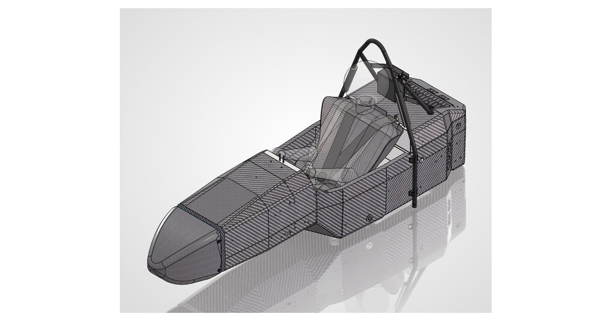

# FTS-435 : Design & Optimization of the Frame system for FSAE

**CDE4301 Innovation & Design Capstone, interim report · NUS Formula SAE**

**▶ Read the report: https://ryanfong5.github.io/FTS-435-Fsae-Frame-Optimisation-Interim/**

[](https://ryanfong5.github.io/FTS-435-Fsae-Frame-Optimisation-Interim/)

R26e was built to be light, but it failed the rain test and never ran the dynamic events. For R27e we redesigned the frame to pass inspection first, keep water out and open up access, while still cutting mass.

## Key results

| | |
|---|---|
| Frame mass | **−2.44 kg** against R26e |
| Overall car mass (frame, suspension and electronics) | **−6.08 kg** (−15.3 %) |
| Shoulder harness pull test (4T8UD + potting) | Sustained **30.10 kN** (test stopped), meeting the 30 kN requirement |
| Alternative honeycomb core (Huarui) | Matches Corex in punch shear; higher peak in three-point bending |

## Report contents

1. **Problem and design specifications:** what went wrong on R26e and the R27e targets
2. **Design changes:** front monocoque shrink, front roll hoop, integrated rear shelf, main roll hoop, laminate reductions
3. **Fabrication:** pull-test jig, test panels and backing plates, roll hoop bending and welding jig
4. **Testing and results:** shoulder harness pull tests (Tests 1–3 and comparison), honeycomb core comparison, simulation
5. **Mass results:** front, rear and overall mass bridge
6. **Monocoque mould:** options considered and the 3D-printed RTP 385 mould
7. **Problems and plan:** status, key challenges, Semester 2 plan, structural validation (future work) and timeline
8. **Individual contributions**, references and appendices A–J

The report includes interactive 3D models (frame, monocoque layup, integrated shelf and pull-test jig), test data charts and a pull-test time-lapse.

## Team

| | |
|---|---|
| Students | Fong Ken Khai · Wong Yi Tung Shanice |
| Supervisors | Lim Hong Wee · Kenneth Neo |
| Examiner | Soh Eng Keng |

## Repository layout

```
index.html            the report (single page, no build step)
favicon.svg
assets/
  images/             photos, renders, drawings and data sheets
  models/             3D models (.glb) shown in the interactive viewers
  video/              pull-test time-lapse
  docs/               supplier data sheet (PDF)
```

## Viewing locally

The 3D viewers load their models with `fetch`, so open the page through a local web server rather than by double-clicking the file:

```bash
python3 -m http.server 8000
# then open http://localhost:8000
```

Fonts (Google Fonts) and the 3D library ([three.js](https://threejs.org) r128, via jsDelivr) load from CDNs, so an internet connection is needed for the full experience.

## Publishing

The site is served by GitHub Pages from the `main` branch root. Any push to `main` updates the live report.

---

© 2026 Fong Ken Khai and Wong Yi Tung Shanice, NUS Formula SAE. Report content, photos and CAD are shared for assessment and reference only. All rights reserved.
